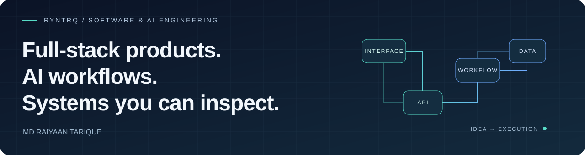

  

# Md Raiyaan Tarique

**Software Development Lead at NetS · Full-stack & AI engineering · Riyadh**

I build software across the interface, API, workflow and data layers. My projects range from AI-assisted developer tools and durable automation to interactive websites, billing engines and a C++ task runtime.

[Portfolio](https://ryntrq.vercel.app) · [LinkedIn](https://www.linkedin.com/in/md-raiyaan-tarique-548956313/) · [Repositories](https://github.com/RynTrq?tab=repositories)

## Start here

Six projects that show how I approach different engineering problems:

| Project | What to look for | Core technologies |
| :--- | :--- | :--- |
| **[Torq-AI](https://github.com/RynTrq/Torq-AI)** | An AI coding workspace: project generation, file editing, multi-provider routing, code execution and GitHub import/export. | TypeScript · Next.js · PostgreSQL |
| **[JobPilot](https://github.com/RynTrq/JobPilot)** | A local macOS application copilot with verified user data, browser automation, local/cloud model routing and human approval. | Python · FastAPI · SwiftUI · Playwright |
| **[Torq Flows](https://github.com/RynTrq/Torq-Flows)** | A visual workflow editor with graph validation, durable execution, API activities and inspectable run history. | FastAPI · Temporal · React Flow |
| **[Taiba Invoicing](https://github.com/RynTrq/Taiba-Invoicing)** | Exact decimal billing, bilingual invoice/report generation and independent calculation checks against workbook fixtures. | TypeScript · Next.js · MongoDB · Python |
| **[DSS2026](https://github.com/RynTrq/DSS2026)** | An interactive IIIT Delhi design-event website with an animated hero, radial programme timeline and circular speaker gallery. | React · Vite · Framer Motion |
| **[Quill Runtime](https://github.com/RynTrq/Quill-Runtime)** | A C++ fork-join runtime with worker-local deques, work stealing, helping waits and concurrency checks. | C++11 · Threads · Atomics |

## The work behind the projects

- **At NetS:** software development across full-stack applications, backend integration and data-intensive systems.
- **Alongside my role:** client projects in AI agents, workflow automation and web/app development, plus AI training and evaluation since 2025.
- **Previously at IIIT Delhi:** interactive HCD department and DSS2026 websites through July 2026; earlier research work on multilingual and multimodal NLP data pipelines.

I care about behavior that can be explained and checked: clear data contracts, explicit workflow state, deliberate failure handling and tests that exercise real rules.

## More to explore

**Client delivery:** [EcomExporter v2](https://github.com/RynTrq/EcomExporter---version-2) — a business website and validated lead-capture workflows.  
**Collaboration:** [Torqussions](https://github.com/RynTrq/Torqussions) — project rooms, real-time chat, shared files, previews and AI-assisted drafting.  
**Systems:** [MeMS](https://github.com/RynTrq/Memory-Management) — a C memory manager with simulated addresses, `mmap` backing and free-range reuse.  
**Data integrity:** [Al-Nur](https://github.com/RynTrq/Al-Nur) — a local solar-settlement demonstration with exact calculations and immutable snapshots.

## Toolkit

**Build:** Python, TypeScript, JavaScript, C++, C, Java · React, Next.js, FastAPI, Node.js  
**Data & execution:** PostgreSQL, MongoDB, SQLite, Temporal · Docker, Git  
**Quality:** Playwright, Vitest, validation, independent reference calculations

For project setup, architecture, constraints and verification commands, start with the individual repository READMEs.
